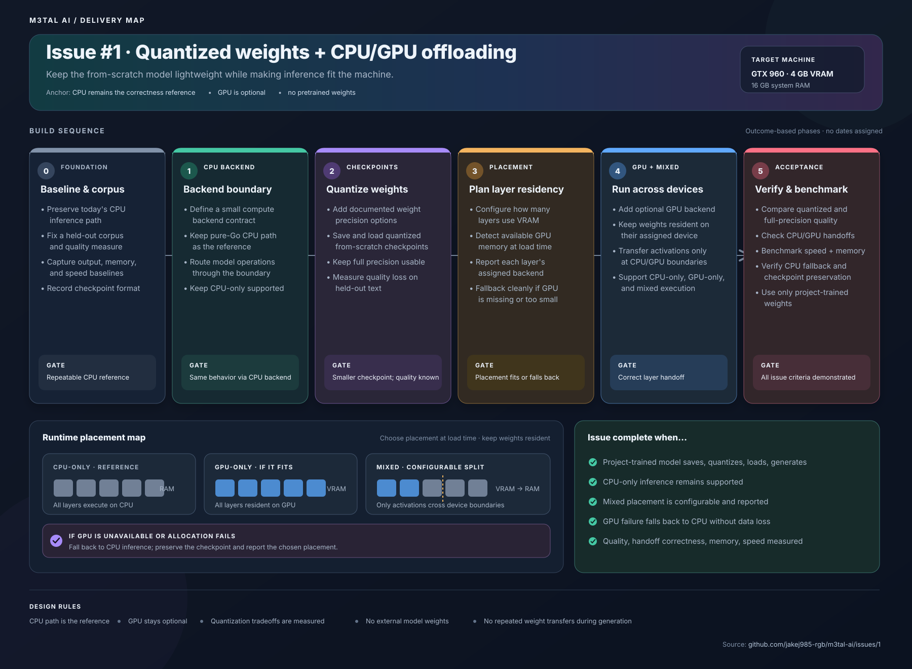

# Issue #1: Quantized weights and CPU/GPU layer offloading

This visual delivery map expands the [GitHub issue](https://github.com/jakej985-rgb/m3tal-llm/issues/1) into implementation phases, runtime placement modes, and an acceptance gate. It uses the issue's stated constraints and acceptance criteria; it does not assign dates.

See [ROADMAP.md](ROADMAP.md) for the broader M3TAL AI product roadmap.
